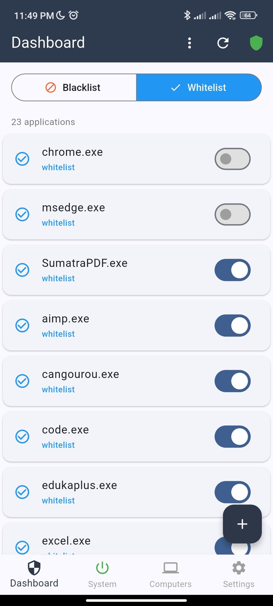
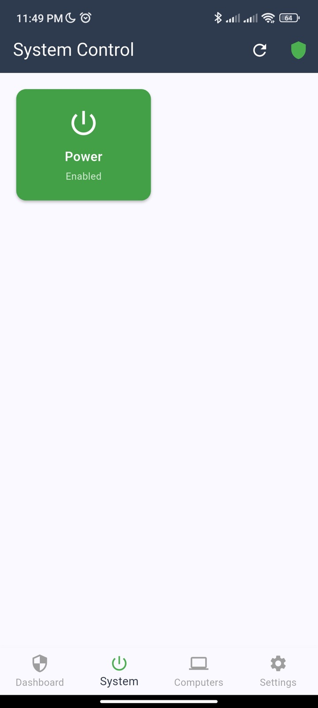
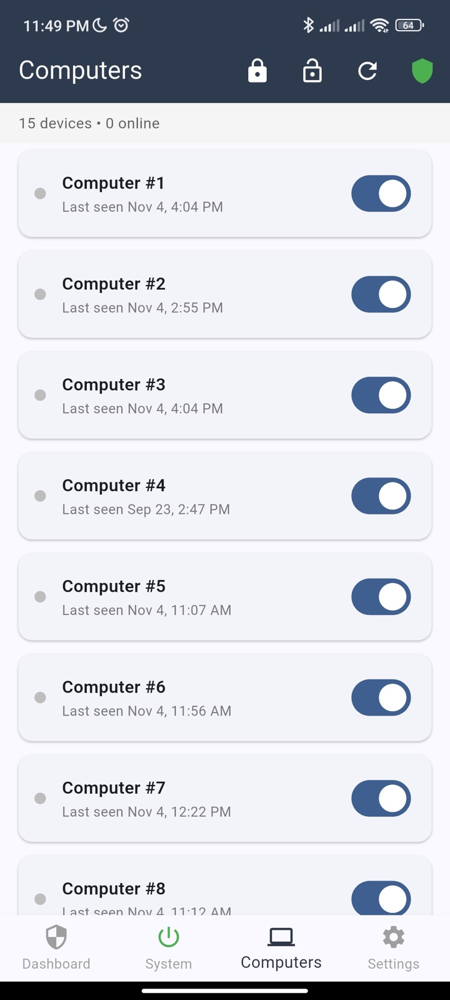
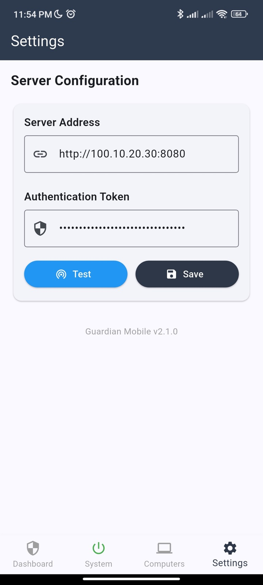

<div align="center">

<p align="center">
  
</p>


**Process monitoring and control system — block or whitelist applications across Windows machines, manage them remotely from an Android app, all coordinated through a central server.**

[](LICENSE)
[](server/)
[](agent/)
[](mobile/)
[](https://flutter.dev)

[**Quick Start**](#quick-start) · [Architecture](#architecture) · [API Reference](#api-reference) · [Issues](../../issues)

</div>

<br />

## Screenshots

<p align="center">
  
  
  
  
</p>

---

## Quick Start

Download `guardian-<version>.zip` from [Releases](https://github.com/nazdravan/guardian/releases)
and unpack it:

```
guardian-<version>/
├── server/                          # Linux server
│   ├── guardian-server              # Server binary (linux/amd64)
│   ├── server.env                   # Server config template
│   ├── install.sh                   # Install as a systemd service
│   ├── guardian-server.service
│   ├── Dockerfile
│   └── docker-compose.yml
├── agent-windows/
│   ├── Guardian.exe                 # Guardian Console: install, diagnose, edit whitelist
│   ├── agent.env                    # Agent config template
│   ├── Install-Guardian.bat         # Auto-detect arch and install agent
│   ├── Uninstall-Guardian.bat       # Auto-detect arch and uninstall
│   └── bin/                         # PowerShell installers + 32/64-bit agent
├── agent-linux/
│   ├── procsentinel-agent           # Agent binary (linux/amd64)
│   ├── agent.env                    # Agent config template
│   ├── install.sh / uninstall.sh
│   └── guardian-agent.service
└── guardian.apk                     # Mobile app (Android)
```

To build the archive yourself: `./scripts/package.sh` → `dist/guardian-<VERSION>.zip`.

### 1. Server (Linux)

Copy `server/` to your server, then rename and configure the env file:

```bash
cp server.env .env
```

```env
SERVER_ADDRESS=http://0.0.0.0:8080
TOKEN=your_token_here
ADMIN_TOKEN=your_admin_token_here
```

Run it one of three ways:

```bash
./guardian-server        # Option A — run directly
sudo ./install.sh        # Option B — install as a systemd service
docker compose up -d     # Option C — Docker (env is optional; pass vars via compose)
```

### 2. Agent (Windows)

Edit `agent.env` with your server details:

```env
SERVER_ADDRESS=your_server_address
TOKEN=your_token_here
```

Double-click `Install-Guardian.bat` (auto-detects 32/64-bit and runs the right installer as admin). The installer prompts for an optional `IDENTITY` number to register the computer with the server. To remove it, double-click `Uninstall-Guardian.bat`.

### Agent (Linux)

Edit `agent-linux/agent.env`, then run `sudo ./install.sh` from that folder. It installs the
agent to `/opt/guardian-agent/` as the `guardian-agent` systemd service. Review
`/opt/guardian-agent/whitelist.txt` after the first start; `sudo ./uninstall.sh` removes it.

### 3. Mobile app (Android)

Install `guardian.apk`, open the app, go to **Settings**, and set the server address and admin token.

---

## Architecture

```
+-----------+         +--------+         +-------+
|  Mobile   | ------> | Server | <------ | Agent |
| (Android) |  Admin  | (Linux)|  Client | (Win) |
+-----------+  Token   +--------+  Token  +-------+
                          |
                       [SQLite]
```

The Android app talks to the server with the **admin** token; agents talk to it with the **client** token. The server keeps blocked apps, modes, computer registrations, and client entries in SQLite, with in-memory caches in front.

---

## Modes

| Mode | Behavior |
|---|---|
| **blacklist** | Only processes in the block list are killed |
| **whitelist** | All processes NOT in the allow list are killed (system processes excluded) |
| **free** | No processes are killed (returned when the server is disabled or a computer is unblocked) |

---

## API Reference

All endpoints except `/health` require an `Authorization: Bearer <token>` header.

### Client (TOKEN auth)

| Method | Endpoint | Description |
|---|---|---|
| GET | `/client/sync?identity={id}` | Agent sync — returns applications, mode, and client entries |

### Admin (ADMIN_TOKEN auth)

**Applications**

| Method | Endpoint | Description |
|---|---|---|
| GET | `/manage/applications` | List all applications |
| POST | `/manage/applications` | Add application (name, mode) |
| PUT | `/manage/applications` | Update application (name, enabled, mode) |
| DELETE | `/manage/applications` | Remove application (name, mode) |
| DELETE | `/manage/applications/reset` | Clear all applications |

**Status**

| Method | Endpoint | Description |
|---|---|---|
| GET | `/status` | Get server enabled state and mode |
| PUT | `/status` | Update enabled state and/or mode |
| GET | `/info` | Server info (IP, port, version, status) |

**Client Entries**

| Method | Endpoint | Description |
|---|---|---|
| GET | `/client` | List all client entries |
| PUT | `/client` | Update a client entry (name, status) |

**Computers**

| Method | Endpoint | Description |
|---|---|---|
| GET | `/manage/computers` | List computers with block status and last seen |
| PUT | `/manage/computers` | Set computer blocked status (identity, blocked) |
| DELETE | `/manage/computers/reset` | Unblock all computers |
| PUT | `/manage/computers/block_all` | Block all computers |

**Unauthenticated**

| Method | Endpoint | Description |
|---|---|---|
| GET | `/health` | Health check |

---

## Remote Shutdown

Setting the `power` client entry to `false` via the `/client` endpoint triggers a system shutdown on all connected agents. On Windows this uses the `InitiateSystemShutdownExW` API to force-close applications and power off the machine.

---

## Configuration

### Server `.env`

| Variable | Description | Example |
|---|---|---|
| `SERVER_ADDRESS` | Listen address | `http://0.0.0.0:8080` |
| `TOKEN` | Client/agent auth token | `your_token_here` |
| `ADMIN_TOKEN` | Admin/mobile auth token | `your_admin_token_here` |

### Agent `.env`

| Variable | Description | Example |
|---|---|---|
| `SERVER_ADDRESS` | Server URL | `http://192.168.1.10:8080` |
| `TOKEN` | Client auth token (must match server) | `your_token_here` |

---

## Build Requirements

- **Go 1.25+** for server and agent
- **Flutter 3.x** for the mobile app
- Agent Windows builds require PowerShell and `CGO_ENABLED=1`
